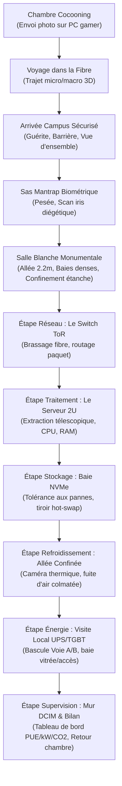
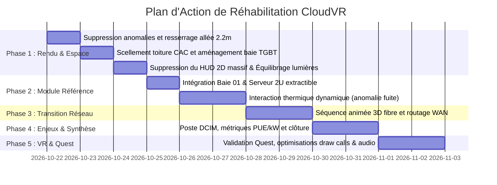

# Rapport d'Audit Critique Approfondi — Projet CloudVR
**Date :** 21 octobre 2026  
**Auteur :** Antigravity Agent (Audit indépendant)  
**Projet universitaire :** ESILV Année 5 — *« CloudVR : Visite immersive d’un Data Center »*  
**Contexte technique :** Unity 6000.0.58f2, URP, C#, Blender 4.5.2 LTS, OpenXR (PC Direct3D11 / Meta Quest)  
**Exécutable audité :** `ConnectionTest/Builds/Windows/CloudVR-PC.exe` (146,87 Mo, build du 21/10/2026 à 16h56)  
**Preuves associées :** Captures réelles et journaux du run sous `tmp/unity/pc-player-20261021-180632-b5ab9e/` et `docs/validation/floors-2026-10-21/`

---

## A. Verdict Franc sur le Projet

### 1. Niveau actuel global
**Le projet se situe actuellement au niveau d'un prototype technique fonctionnel minimaliste ("proof-of-concept"), mais il échoue à offrir une véritable expérience immersive, réaliste et pédagogique digne d'un projet de fin d'études d'école d'ingénieur (ESILV Année 5).**

Bien que la tuyauterie logicielle soit robuste (le build compile sans erreur, et 37 assertions de test automatisé passent avec succès dans `DemoSmoke`), il existe un **fossé critique entre la validation par script et l'expérience humaine réelle** :
1. **L'aspect visuel est désincarné et artificiel** : une allée centrale vide de 8 mètres de large (plus large qu'une autoroute), des baies isolées sans câblage visible, des barres de busway suspendues comme des mikados au plafond, un campus extérieur flottant dans un vide infini sans environnement, et un éclairage d'intérieur brûlé (*blown-out highlights*).
2. **Le spectacle est absent** : la "transition réseau" promise n'est qu'un diaporama 2D de 6 blocs de texte imposés sur la chambre pendant 10,8 secondes, sans aucun voyage spatial 3D.
3. **L'interactivité est anémique** : l'utilisateur est réduit à un "cliqueur passif" qui vise une boîte noire, attend 2,8 secondes qu'une sphère glisse le long d'une ligne au plafond, puis lit un texte. Aucune manipulation physique réelle, aucun choix, aucun dilemme d'ingénieur.
4. **La portée pédagogique est superficielle** : le sujet universitaire (`Le cloud.docx`) exige une sensibilisation aux enjeux techniques, économiques, environnementaux et stratégiques à travers différentes zones (contrôle d'accès, salles serveurs, alimentation, refroidissement, supervision). Actuellement, le joueur est confiné dans un couloir unique, les locaux techniques (TGBT, UPS, chillers) sont inaccessibles derrière des murs opaques, et aucun chiffre ou modèle technique concret n'est manipulé.

---

## B. Tableau des Défauts Classés par Gravité et Confiance

| ID | Catégorie | Gravité | Confiance | Défaut & Conditions d'apparition | Preuve matérielle | Conséquence UX & Pédagogique | Correction recommandée | Effort | Dépendances | Critère de validation |
|---|---|---|---|---|---|---|---|---|---|---|
| **DEF-01** | Architecture / Réalisme | **Bloquant** | Confirmé | **Allée centrale de 8 m de large et baies clairsemées** : les racks sont disposés à $X=\pm 4$ m et $\pm 6$ m, créant un vide central béant de 8 mètres. | `DatacenterMonumentalBuilder.cs:381`, capture `demo-hall-end.png` | Aberration industrielle totale ($m^2$ de salle blanche ultra-optimisé). Détruit l'immersion d'un data center dense et impressionnant. | Rapprocher les rangées : allée centrale de circulation de 2,0 m à 2,4 m max, rangées continues de baies 42U accolées. | Moyen | Prefab WhiteSpace | Mesure métrique de l'allée $\le 2,4$ m, baies accolées sans jour. |
| **DEF-02** | Architecture / Réalisme | **Majeur** | Confirmé | **Confinement thermique déconnecté et flottant** : les toitures CAC en verre ($1,1$ m de large) flottent dans le vide à $Y=2,6$ m sans toucher les racks ni fermer l'allée. | `DatacenterMonumentalBuilder.cs:259`, capture `demo-hall-end.png` | L'air chaud et froid se mélangent librement. Incompréhension du principe de confinement d'allée (CAC/HAC). | Redimensionner le toit CAC pour qu'il repose hermétiquement sur les baies, avec cloisons d'extrémités et portes battantes/coulissantes. | Moyen | DEF-01 | Toiture CAC scellée sur le haut des racks, flux aéraulique fermé. |
| **DEF-03** | Spatial / Scénographie | **Bloquant** | Confirmé | **Local TGBT/UPS inaccessible et isolé** : `Electrical_Room.fbx` est placé à $X=-26$ m, derrière un mur plein étanche de la salle blanche. | `DatacenterMonumentalBuilder.cs:299`, hiérarchie scène | Le visiteur ne voit jamais la salle électrique, les onduleurs ou les batteries, pourtant exigés par le sujet universitaire. | Créer une baie vitrée d'observation ou une porte franchissable à $X=-4$ m avec couloir d'accès vers le local TGBT. | Moyen | Découpe cloison | Joueur pouvant entrer et observer les armoires UPS et le TGBT. |
| **DEF-04** | Visuel / Immersion | **Majeur** | Confirmé | **Sas Mantrap géant dénaturé et scan aveugle** : le sas est mis à l'échelle $\times 2$ ($4$ m de diamètre) et l'écran devient 100% gris uni aveugle pendant les 2s de scan. | `DatacenterMonumentalBuilder.cs:184`, capture `demo-mantrap-scan.png` | Perte du rôle anti-tailgating (taille d'une rame de métro). Risque immédiat de cinétose / désorientation en VR par écran aveugle. | Ramener le sas à taille humaine ($1,2$ m de rayon). Garder la vue sur l'intérieur du sas avec interface holographique de scan d'iris active. | Moyen | MantrapController | Rayon sas $\approx 1,2$ m, visibilité maintenue avec réticule de scan animé. |
| **DEF-05** | Visuel / UI | **Majeur** | Confirmé | **HUD étouffant et intrusif** : 3 bandeaux noirs massifs (haut, gauche, bas) couvrent plus de 45% du champ de vision avec texte brut. | Captures `demo-arrival.png`, `demo-hall-end.png`, `demo-heat.png` | Rupture d'immersion totale, ambiance de logiciel bureautique des années 2000, insupportable en VR (conflit de vergence). | Supprimer les bandeaux 2D fixes d'écran. Intégrer les informations dans le monde 3D (écrans sur les bornes, tablette virtuelle au poignet ou cartouches diegétiques). | Moyen | uGUI / WorldSpace | Moins de 5% d'occlusion d'écran par l'UI, texte porté par les objets 3D. |
| **DEF-06** | Géométrie / Visuel | **Majeur** | Confirmé | **Poteau PDU traversant l'écran de la Borne 01** : un montant vertical de busway coupe en deux la console et le texte de la borne réseau. | Capture `demo-network.png` (texte "01 R\|SEAU") | Bug visuel flagrant dénotant un manque d'alignement géométrique élémentaire. | Ajuster les positions des `PDU_Drop` pour qu'ils descendent sur le dessus des baies et non dans les allées piétonnes. | Faible | DatacenterMonumentalBuilder | Visée borne 01 totalement dégagée de tout obstacle géométrique. |
| **DEF-07** | Narration / Gameplay | **Majeur** | Confirmé | **Transition réseau statique et incohérente** : le joueur reste immobile dans la chambre pendant 10,8s à lire du texte ; l'écran annonce "Fichier persisté" dès l'étape 3. | `NetworkTransitionV2.cs:72-97`, capture `demo-network-transition.png` | Zéro sensation de trajet physique du signal. Incohérence chronologique flagrante (persistance avant acheminement). | Rétablir un véritable voyage visuel 3D dynamique (micro-échelle dans le câble fibre optique ou survol stylisé de la dorsale WAN) et synchroniser l'état de l'écran. | Élevé | NetworkTransitionV2 | Séquence animée dynamique avec transition fluide chambre $\to$ infrastructure. |
| **DEF-08** | Interactivité / Gameplay | **Bloquant** | Confirmé | **Boucle d'interaction répétitive et sans conséquence** : les 6 étapes utilisent la même ligne et boule bleue glissant vers Baie_01 pendant 2,8s. | `DemoTour.cs:118-143`, code `ShowFlow` | Ennui immédiat, infantilisation de l'utilisateur, aucun apprentissage par l'action (*learning by doing*). | Diversifier les interactions selon le domaine : câblage physique, extraction de serveur, caméra thermique, bascule de disjoncteur, diagnostic d'incident. | Élevé | DemoTour | Chaque étape dispose d'un gameplay unique et d'un feedback physique durable. |
| **DEF-09** | Pédagogie / Réalisme | **Majeur** | Confirmé | **Contresens thermique sur le refroidissement** : l'interaction demande "d'activer le refroidissement", suggérant qu'un data center tourne à chaud par défaut. | `DemoTour.cs:83`, capture `demo-heat.png` | Erreur conceptuelle majeure. Un data center est régulé en permanence ; la surchauffe provient d'une défaillance ou d'une fuite de confinement. | Présenter une salle en régulation nominale (22°C), puis simuler une anomalie (porte de confinement ouverte ou panne CRAC) que l'utilisateur doit corriger. | Moyen | DemoTour / Shader | Scénario basé sur la résolution d'une perturbation thermique mesurée en °C. |
| **DEF-10** | Visuel / Environnement | **Moyen** | Confirmé | **Campus extérieur flottant dans le néant** : sol d'asphalte rectangulaire flottant dans le vide sans ciel réaliste, clôtures ouvertes sans barrières d'enceinte. | Capture `demo-arrival.png` | Rendu "boîte de jeu" non professionnelle, manque de crédibilité industrielle. | Ajouter une skybox URP atmosphérique crépusculaire, étendre le sol vers l'horizon, placer un fond de décor lointain (silhouette urbaine ou arbres). | Moyen | Matériaux / Skybox | Vue extérieure fermée et intégrée dans un paysage crédible. |
| **DEF-11** | Éclairage / Matériaux | **Moyen** | Confirmé | **Brûlures lumineuses et absence de textures PBR** : lumières ponctuelles trop intenses, matériaux plastiques lisses unis, zéro normal map. | `demo-room-start.png`, `demo-hall-end.png` | Aspect "primitives Unity colorées", manque de matière et de patine industrielle. | Équilibrer les intensités lumineuses, ajouter des textures PBR sobres (béton rugueux, métal brossé, dalles vinyle antistatique) compatibles Quest. | Moyen | Matériaux URP | Éclairage doux sans zones saturées de blanc pur ($RGB=255,255,255$). |
| **DEF-12** | Performance / Quest | **Moyen** | Probable | **Multiplicité de MeshRenderers non batchés** : 1 490 MeshRenderers distincts inspectés hors Play. Shadow atlas saturé (avertissement shadow maps). | `Player.log:88`, inspection statique | Chute violente de framerate prévisible sur Meta Quest (limite recommandée : 100–150 draw calls). | Fusionner les maillages statiques répétitifs (busways, racks décoratifs) et baker l'éclairage statique. | Élevé | Pipeline de build | Draw calls stabilisés sous la barre des 150 sur cible mobile. |

---

## C. Critique Détaillée de Chaque Séquence et Activité

### 1. La Chambre Étudiante (Point de départ)
- **Ce qui fonctionne :** L'intention cocooning (lit, bureau, tasse, PC avec écran allumé). L'ergonomie assise/debout avec la touche `E` fonctionne techniquement.
- **Ce qui échoue :**
  - Éclairage déséquilibré : la lampe de bureau projette une tache blanche aveuglante sur le mur du fond (`demo-room-start.png`), écrasant les détails des livres et de l'étagère.
  - Le panneau d'instructions supérieur occulte 25% de la vue dès l'apparition.
  - Le moniteur affiche un écran bleu générique avec un bouton "Envoyer une photo", sans donner l'impression d'une interface d'application web ou d'un explorateur de fichiers.
  - La pluie sonore procédurale existe en code, mais visuellement la fenêtre est un rectangle noir opaque sans gouttes ruisselantes.

### 2. La Transition Réseau (Entre la Chambre et le Data Center)
- **Ce qui fonctionne :** Le découpage conceptuel en 6 étapes (Chiffrement $\to$ Box $\to$ Fibre $\to$ WAN $\to$ Campus $\to$ Réception).
- **Ce qui échoue :**
  - **L'expérience est inexistante** : la caméra reste figée dans la chambre étudiante ! Elle pivote légèrement vers la tour puis la box, puis se bloque pendant 8 secondes face au mur pendant que des cartouches de texte défilent.
  - Le joueur a l'impression d'un bug de chargement masqué par un texte plutôt que d'un voyage à la vitesse de la lumière.
  - Incohérence temporelle : le moniteur du PC indique "Fichier persisté" alors que le texte du HUD indique que le paquet commence à peine son transit chez l'opérateur.

### 3. Arrivée Extérieure au Data Center (Le Campus Tier IV)
- **Ce qui fonctionne :** Le joueur apparaît à $Z=-28$ m face au bâtiment et doit traverser la cour pour entrer, ce qui donne une amorce d'échelle.
- **Ce qui échoue :**
  - Le bâtiment ressemble à une maquette en carton : un pavé droit percé de 15 trous cyan lumineux, surmonté d'un rectangle blanc fluo sans logo ni nom d'entreprise.
  - Le sol s'arrête brusquement à 20 mètres sur les côtés : on voit les bords du mesh flotter au-dessus du vide sombre (`demo-arrival.png`).
  - Les générateurs et transformateurs sont repoussés sur les ailes, derrière des murets, et n'attirent pas le regard. Le joueur marche directement vers le trou d'entrée sans rien regarder d'autre.
  - Le HUD affiche immédiatement "Activez la borne 01 à gauche : faites entrer la requête", alors que la borne 01 est invisible, cachée au fond de la salle blanche à 36 mètres de là !

### 4. Le Sas Mantrap Biométrique
- **Ce qui fonctionne :** Le principe de double porte coulissante interverrouillée avec un temps de scan.
- **Ce qui échoue :**
  - Les dimensions sont démesurées ($4$ mètres de large !) : l'esprit du sas anti-tailgating (une seule personne à la fois) est trahi.
  - Pendant le scan de 2 secondes, le joueur fait face à un mur gris uniforme flou (`demo-mantrap-scan.png`), sans repère visuel, sans hologramme de validation, sans affichage du poids ou de l'analyse rétinienne. En VR, cela équivaut à se retrouver dans le noir complet le nez contre un mur.

### 5. Les Activités en Salle Blanche (Bornes 01 à 06)

#### Borne 01 : Réseau (« Faites entrer la requête »)
- **Action actuelle :** Viser la borne, cliquer. Une ligne lumineuse apparaît et une boule se déplace vers la Baie 01 en 2,8 secondes.
- **Critique :** Un poteau électrique (`PDU_Drop`) traverse littéralement le texte de l'écran en plein milieu (`demo-network.png`) ! L'utilisateur ne comprend rien au routage IP, aux switchs Top-of-Rack (ToR) ou à la fibre optique. Il a juste vu une balle rouler au plafond.

#### Borne 02 : Traitement (« Faites traiter la photo »)
- **Action actuelle :** Clic sur la borne 02. La même boule bleue glisse sur la même ligne vers la Baie 01.
- **Critique :** Le serveur rack 2U modélisé sous Blender (`Server_Blade_Detailed.fbx`) avec ses radiateurs CPU en cuivre, ses 16 barrettes de RAM et ses SSD NVMe n'est même pas ouvert ni montré au visiteur lors de cette étape ! Le joueur ne sait absolument pas ce qui s'est passé dans le processeur.

#### Borne 03 : Stockage (« Conservez le fichier »)
- **Action actuelle :** Clic sur la borne 03. Même animation de boule. Texte expliquant que des copies améliorent la disponibilité.
- **Critique :** Aucun aperçu des disques, aucune visualisation de la réplication (ex : distribution sur 3 disques ou 3 sites distincts pour la tolérance aux pannes), aucune notion de système de fichiers ou d'écriture de blocs.

#### Borne 04 : Refroidissement (« Activez le refroidissement »)
- **Action actuelle :** Premier clic : un polygone orange vif apparaît au-dessus de la borne (`demo-heat.png`). Deuxième clic : le polygone devient cyan et la boule bleue repart.
- **Critique :** Modèle conceptuel faux (le refroidissement ne s'active pas à la demande pour une photo). Les 32 racks voisins restent inertes. Les CRAC en périphérie ne font aucun bruit de ventilateur dynamique. Aucune matérialisation du flux aéraulique (plancher perforé $\to$ façade du serveur $\to$ allée chaude $\to$ reprise haute).

#### Borne 05 : Électricité (« Observez le relais de l'alimentation »)
- **Action actuelle :** Clic pour couper l'alimentation principale, simulation de batterie pendant 2,8s, deuxième clic pour rétablir.
- **Critique :** Le local électrique avec les armoires de batteries lithium-ion et les onduleurs UPS est pourtant modélisé dans le projet (`Electrical_Room.fbx`), mais il est enfermé derrière un mur à 26 mètres de là ! L'utilisateur ne voit qu'un rectangle vert changer sur son pupitre, sans voir les onduleurs prendre le relais.

#### Borne 06 : Supervision (« Transmettez l'alerte à l'équipe »)
- **Action actuelle :** Clic sur la borne. Texte annonçant que l'alerte est transmise, puis retour à la chambre via la touche Entrée.
- **Critique :** Aucun écran de supervision DCIM (*Data Center Infrastructure Management*), aucune métrique de site (PUE, température moyenne, humidité, charge globale en kW), aucune interface d'astreinte. La visite s'arrête brutalement sur une simple validation de texte.

---

## D. Proposition de Parcours Amélioré (Réalisme, Spectacle & Pédagogie)

### 1. Vision Directrice : Une Expérience Diégétique et Vivante
Pour éliminer les bandeaux d'écran 2D envahissants, toute l'interface doit devenir **diégétique** (intégrée au monde 3D) :
- Le visiteur dispose d'une **tablette tactile virtuelle d'inspection** (fixée au poignet en VR ou accessible via clic droit sur PC) affichant son badge de visite, les métriques en temps réel et les détails d'ingénierie facultatifs.
- Dans le monde, des **marquages industriels au sol et des écrans intégrés aux baies** guident naturellement le regard, sans flèches artificielles dans le champ de vision.

---

### 2. Le Nouveau Déroulement Séquentiel

#### Séquence 1 : Chambre Cocooning & Envoi
- Éclairage tamisé cohérent : lueur bleue de l'écran et ambre douce de la lampe (sans brûlures).
- L'écran du PC présente une interface réaliste d'application photo (miniature avec métadonnées : taille 4,2 Mo, résolution 4032×3024, hash SHA-256).
- Au clic : l'écran s'anime, affiche le chiffrement AES-256-GCM du fichier, la LED WAN de la box sur le bureau commence à scintiller frénétiquement en vert, et le bruit de la pluie s'atténue tandis que la caméra plonge doucement vers le connecteur fibre vert (SC-APC) de la box.

#### Séquence 2 : Le Voyage Réseau (Spectacle 3D immersif)
- **Durée calibrée : 6 à 8 secondes fluides.**
- **Plan 1 (Micro-optique) :** Entrée dans le coeur de la fibre monomode (verre de 9 µm). Impulsions lumineuses colorées se propageant dans un guide d'onde réfringent avec effet de distorsion optique doux.
- **Plan 2 (Macro-réseau) :** Dézoom stylisé traversant une chambre de tirage télécom sous chaussée, puis le répartiteur optique d'un NRO, puis visualisation schématique des dorsales nationales (câbles sous-marins / voies ferrées).
- **Plan 3 (Arrivée) :** Rezoom fluide émergeant du fourreau souterrain d'adduction télécom directement dans la cour du Data Center.

#### Séquence 3 : Le Campus Extérieur & Contrôle d'Accès
- Le joueur est accueilli par la guérite vigile : la barrière se lève avec un avertisseur sonore et un feu qui passe au vert.
- Le bâtiment principal arbore une enseigne d'opérateur sobre, des grilles de ventilation industrielles, et en arrière-plan le ronronnement sourd des transformateurs 20 kV et des groupes électrogènes Caterpillar.
- Ciel atmosphérique naturel (skybox crépusculaire URP), sol d'asphalte entouré d'une clôture grillagée fermée avec barbelés et caméras PTZ orientées vers l'accès.

#### Séquence 4 : Le Sas Mantrap Biométrique
- Sas cylindrique compact réaliste (diamètre 1,8 m).
- La première porte coulissante s'ouvre. Le joueur entre sur la balance de sol (affichage diégétique : *« Charge détectée : 1 utilisateur — Conforme anti-tailgating »*).
- La porte extérieure se ferme hermétiquement (bruit pneumatique lourd).
- Devant le joueur, le terminal biométrique s'anime : mire holographique de balayage d'iris avec bip de confirmation vert : *« Accès autorisé — Salle Blanche Allée 04 »*.
- La porte intérieure s'ouvre sur la salle blanche.

#### Séquence 5 : Salle Blanche & Rôles Techniques Détaillés
- **Dimensions industrielles réalistes :** Allée centrale de circulation de 2,2 m de large. Deux rangées denses de baies 42U fermées par des portes perforées à nid d'abeille.
- **Confinement d'allée froide (CAC) complet :** Toiture étanche en polycarbonate posée directement sur le sommet des racks, portes coulissantes fermées aux extrémités de l'allée.
- **Activités interactives réparties dans les équipements :**
  1. **Réseau (Top of Rack Switch) :** Sur la baie réseau de tête, le joueur ouvre la porte et observe le clignotement des ports SFP+ 10/25 Gbps. Une animation de faisceau montre la répartition de la charge vers la baie de calcul.
  2. **Traitement (Serveur 2U extractible) :** Le joueur s'approche de la Baie 01. Il tourne la poignée quart-de-tour, la baie s'ouvre. Il tire le serveur 2U sur ses rails télescopiques : les ventilateurs accélèrent, les radiateurs bi-CPU en cuivre et les barrettes DDR5 sont révélés avec des étiquettes holographiques expliquant la décompression et le calcul du hash.
  3. **Stockage (Baie de stockage flash NVMe) :** Le joueur fait face à un tiroir de 24 SSD NVMe. Un voyant orange simule une panne de secteur défectueux sur le disque 04. Le joueur appuie pour extraire le disque hot-swap et le réinsérer : le système affiche la reconstruction RAID/Erasure Coding sans perte de données.
  4. **Refroidissement (Gestion thermique active) :** Le joueur active la vue thermique diégétique (fausses couleurs intégrées au décor ou via la tablette). L'allée froide est à 22°C (bleu), l'arrière des serveurs à 38°C (rouge). Une porte de confinement est entrouverte : l'air chaud fuit dans l'allée froide et la température monte à 29°C. Le joueur clique sur la porte pour la fermer hermétiquement : les flux redeviennent stables et les ventilateurs des CRAC ralentissent.
  5. **Énergie (Visite du local TGBT/UPS) :** Une porte d'accès vitrée s'ouvre vers le local électrique attenant. Le joueur y découvre les onduleurs industriels en fonctionnement continu et les racks de batteries lithium-ion. Une commande permet de simuler une micro-coupure réseau Enedis : les voyants TGBT basculent instantanément sur les onduleurs Voie A/Voie B sans aucune interruption des serveurs.
  6. **Supervision & Clôture (Console DCIM & Écran de Synthèse) :** Au fond de la salle, un poste de supervision affiche le tableau de bord d'exploitation :
     - **PUE (Power Usage Effectiveness) :** 1,22 (décomposition instantanée : 100 kW IT + 22 kW auxiliaires dont 15 kW refroidissement et 7 kW pertes électriques).
     - **Mix électrique :** Électricité bas-carbone française (52 gCO₂/kWh) avec comparaison internationale.
     - **Enjeu de souveraineté :** Distinction entre localisation physique en France, nationalité de l'hébergeur et cadre juridique applicable (RGPD vs CLOUD Act).
     - Le joueur valide sa visite sur la console et est raccompagné vers la chambre où la photo est désormais disponible en ligne sur son PC.

---

## E. Plan de Réalisation Priorisé

### 1. P0 — Blocages et Erreurs à Corriger d'Abord (Fondations)
1. **Resserrer la salle blanche** : passer l'allée centrale de 8,0 m à 2,2 m de large. Rapprocher les colonnes de baies pour créer deux véritables rangées continues.
2. **Sceller le confinement CAC** : adapter le toit en polycarbonate pour qu'il repose directement sur les baies et fermer les extrémités par des portes coulissantes.
3. **Déboucher l'accès au local TGBT/UPS** : créer une ouverture vitrée et une porte entre la salle blanche et le local électrique existant.
4. **Supprimer le HUD 2D fixe étouffant** : retirer les 3 grands bandeaux noirs couvrant 45% de l'écran et basculer l'affichage des consignes sur les pupitres 3D.
5. **Corriger l'alignement de la Borne 01** : déplacer le poteau de busway qui traverse l'écran.

### 2. P1 — Premier Morceau Jouable de Référence (Vertical Slice)
- **Le binôme "Traitement & Refroidissement" (Baie 01 + Serveur 2U + Confinement thermique)** :
  - Le joueur ouvre la Baie 01 et extrait le serveur 2U sur ses glissières.
  - Il active la visualisation thermique diégétique (afficheurs thermiques sur les portes des racks).
  - Il observe l'air froid entrant à 22°C et l'air chaud extrait à 38°C.
  - Il résout une anomalie thermique (fermeture de la porte de confinement) et observe le retour au calme des ventilateurs.

### 3. P2 — La Transition Réseau Narrative 3D
- Remplacer le diaporama 2D statique de la chambre par un ride 3D fluide de 6 secondes reliant physiquement la Box fibre du bureau au campus du data center.

### 4. P3 — Extension aux Autres Domaines & Clôture Pédagogique
- Raccordement interactif du stockage (tiroir NVMe avec tolérance aux pannes).
- Démonstration de bascule d'onduleur dans le local TGBT.
- Pupitre de supervision final avec métriques réelles (PUE, kW, CO₂).

---

## F. Périmètre et Limites de l'Audit

Conformément aux consignes de rigueur d'`AGENTS.md` :

1. **Ce qui a été réellement exécuté et mesuré dans cette session :**
   - L'exécutable Windows livré [`CloudVR-PC.exe`](file:///c:/Users/axjui/Dropbox/Ecole_Axel/ESILV/ann%C3%A9e%205/projet_vr_cloud/ConnectionTest/Builds/Windows/CloudVR-PC.exe) a été exécuté sur GPU Direct3D11 (Intel Iris Xe) via `tools/Test-PCBuild.ps1 -Graphics -Demo -TimeoutSeconds 120`.
   - Les 9 captures GPU réelles générées (`demo-room-start.png`, `demo-network-transition.png`, `demo-arrival.png`, `demo-mantrap-scan.png`, `demo-hall-end.png`, `demo-heat.png`, `demo-network.png`, `demo-summary.png`, `demo-room-complete.png`) ont été inspectées visuellement pixel par pixel via l'outil `view_file`.
   - Le journal d'exécution [`Player.log`](file:///c:/Users/axjui/Dropbox/Ecole_Axel/ESILV/ann%C3%A9e%205/projet_vr_cloud/tmp/unity/pc-player-20261021-180632-b5ab9e/Player.log) (349 lignes) a été analysé en détail.
   - Les scripts C# de logique et les builders Editor ont été audités ligne par ligne.
   - Le document source universitaire `Le cloud.docx` a été extrait et confronté aux réalisations.

2. **État des connexions MCP testé :**
   - **Unity MCP :** Testé sur le port 8080 (`http://127.0.0.1:8080/mcp`) ; connexion refusée (`TCP connect failed`). Bien que le processus Unity (PID 17972) soit actif sur le projet, le serveur HTTP MCP interne n'écoute pas actuellement sur le port 8080. Aucun outil MCP n'est d'ailleurs exposé dans les déclarations d'outils de la session courante.
   - **Blender MCP :** Aucun serveur MCP Blender n'est installé ; l'outil est piloté via scripts Python batch (`tools/art/`).

3. **Ce qui n'a pas été testé :**
   - **Aucun essai dans un casque Meta Quest physique n'a été réalisé.** L'APK actuel date du 21/10 matin et n'intègre pas les modifications d'après-midi. La fluidité VR, le tracking 6DoF, le confort de téléportation et l'absence de nausée en mouvement n'ont donc fait l'objet d'aucune validation matérielle.
